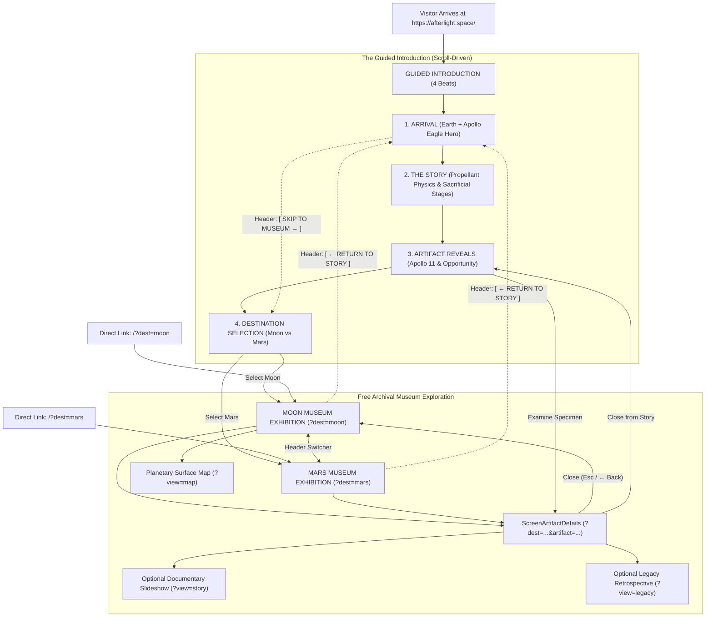
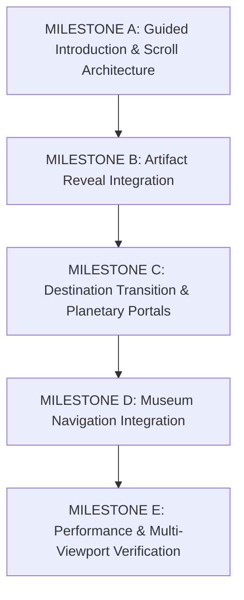

# AFTERLIGHT — PRODUCT EXPERIENCE RESTRUCTURING PLAN
**Architecture, Interaction & Content Specification (Revision 2.1)**

*Document ID: `AFTERLIGHT_PRODUCT_RESTRUCTURE_PLAN.md`*  
*Target Repository: `D:\NASA`*  
*Status: FINAL ARCHITECTURAL SPECIFICATION & PLANNING BLUEPRINT*  
*Notice: Planning specification only. In accordance with execution restrictions, no application source code, components, dependencies, or existing 3D functionality are modified in this phase.*

---

## 1. Executive Summary & Core Strategic Direction

### 1.1 The Product Direction
AFTERLIGHT is a **guided digital museum** dedicated to preserving the history of the machines, landers, and robotic wanderers humanity has left beyond Earth.

The visitor experience is split into two sequential, decoupled phases:
1. **The Guided Introduction (4-Beat Prologue):** An unhurried, editorial scroll narrative explaining *why* equipment remains in space, spotlighting two landmark monuments, and concluding at the destination selector.
2. **The Museum (Free Archival Exploration):** A comprehensive digital museum catalog for the selected planetary world (Moon or Mars) featuring specimen detail cards, 3D hardware inspection stages, orbital topography maps, curatorial audio narration by Dr. Mae Vance, and an optional Legacy retrospective.

```
┌──────────────────────────────────────────────────────────────────────────────────┐
│                           THE GUIDED INTRODUCTION                                │
│                                                                                  │
│   [01. ARRIVAL]  ───>  [02. THE STORY]  ───>  [03. ARTIFACT REVEALS]  ───>      │
│   (Earth + Eagle)      (Sacrificial Physics)   (Apollo 11 & Opportunity)         │
│                                                                                  │
│   ───>  [04. DESTINATION SELECTION] (Marks End of Guided Introduction)           │
│                                │                                                 │
└────────────────────────────────┼─────────────────────────────────────────────────┘
                                 │ Choose Moon or Mars
                                 ▼
┌──────────────────────────────────────────────────────────────────────────────────┐
│                            THE FREE MUSEUM                                       │
│                                                                                  │
│   [05. PLANETARY EXHIBITION] (Moon Catalog  OR  Mars Catalog)                    │
│   • Featured Landmark Centerpiece                                                │
│   • Balanced 2-Column Archival Grid (Standardized 16:10 Plates)                  │
│   • Museum Archival Filter & Search Toolbar                                      │
│                                                                                  │
│   OPTIONAL MUSEUM EXTENSIONS (Preserved):                                        │
│   ├── [Artifact Details Stage] (Component Hotspots, Specs, Dr. Mae Vance Audio)  │
│   ├── [Planetary Surface Map] (Real NASA LOLA / MOLA Topography)                 │
│   ├── [Legacy Chapter] (Optional Curatorial Retrospective per Artifact)          │
│   └── [Surface Roam Mode] (Optional 3D First-Person In-Situ Roam)                │
└──────────────────────────────────────────────────────────────────────────────────┘
```

### 1.2 Core Architectural Principles
1. **Definitive Introduction Boundary:** Destination selection marks the unambiguous end of the guided introduction. After choosing Moon or Mars, the visitor immediately enters the free museum catalog. Visitors are **never** forced to scroll through a compulsory Legacy section after picking a destination.
2. **Single Skip Action:** The guided introduction features exactly one primary skip button (`[ SKIP TO MUSEUM → ]`) that routes the visitor directly to destination selection (Chapter 4). No redundant or competing destination pills in the introduction header.
3. **Strict Destination Scope:** **Moon and Mars only.** Deep Space remains excluded from active destination choices and exhibition routing.
4. **Factual Rigor & No Speculative Aggregates:** Every historical statement and metric is cross-referenced with primary NASA PDS/NSSDC documentation. The unverified "200+ Metric Tons" aggregate has been eliminated and replaced with verified primary-source metrics.
5. **Zero Component Deletion:** Preserves 100% of existing components (`ScreenExhibition`, `ScreenArtifactDetails`, `SceneCanvas`, `SpaceshipCursor`, Dr. Mae Vance audio, and planetary maps).

---

## 2. TASK 1 — MAP THE CURRENT PRODUCT

### 2.1 Existing Screen Audit

| Screen Component | File Location | Functional Purpose | Essentiality | Redundancies & Friction Points | Restructuring Action |
| :--- | :--- | :--- | :--- | :--- | :--- |
| **`ScreenArrival`** | `src/components/ui/ScreenArrival.tsx` | Vertical scroll narrative introducing AFTERLIGHT. | **ESSENTIAL** | Scene 6 destination cards duplicated the separate destination screen. Header had multiple competing CTA buttons. | **Refactor into the dedicated 4-beat Guided Introduction** (Arrival $\rightarrow$ The Story $\rightarrow$ Artifact Reveals $\rightarrow$ Destination Selection). Header streamlined to a single `"Skip to Museum →"` action. |
| **`ScreenDestinationSelect`** | `src/components/ui/ScreenDestinationSelect.tsx` | 3D orbital globe selector (Moon / Mars) with atmospheric telemetry. | **REUSABLE** | Competed with destination cards in the arrival scroll. | **Embed 3D planetary globes into Chapter 4 of the Guided Introduction.** Retain `?state=destinations` as a canonical direct orbital route. |
| **`ScreenExhibition`** | `src/components/ui/ScreenExhibition.tsx` | Digital museum catalog: Featured centerpiece, 2-column secondary grid, archive search, filters, and surface map toggle. | **ESSENTIAL** (Core Museum Exploration Hub) | Lacked a prominent `"← RETURN TO STORY"` button when entered from the guided journey. | **Preserve as the primary free exploration hub.** Add explicit `"← RETURN TO STORY"` and destination switching controls in the sticky header. |
| **`ScreenArtifactDetails`** | `src/components/ui/ScreenArtifactDetails.tsx` | Full-screen modal overlay for deep inspection of an individual artifact (photos, 3D model, component hotspots, specs, Dr. Mae Vance curatorial narration). | **ESSENTIAL** (Core Specimen Viewer) | None. Highly functional (~416px curatorial card height verified on 768px viewports). | **Preserve 100% intact.** Reused identically whether opened from a story reveal or the museum catalog. |
| **`ScreenDocumentary`** | `src/components/ui/ScreenDocumentary.tsx` | Multi-chapter full-bleed photographic story slideshow (`storyChapters`), autoplay, and floating curator. | **INTEGRABLE** | Isolated state (`STORY_CHAPTER`) only reachable by clicking deep inside an artifact. | **Retain as an optional deep-dive slideshow** accessible from `ScreenArtifactDetails` (`?view=story`). |
| **`ScreenLegacy`** | `src/components/ui/ScreenLegacy.tsx` | Philosophical conclusion screen summarizing artifact status, in-situ condition, and verified NASA sources. | **OPTIONAL RETROSPECTIVE** | Previously trapped users at the end of the documentary slideshow (`LEGACY`). | **Reposition as an optional curatorial retrospective** accessible from `ScreenArtifactDetails` (`?view=legacy`), rather than a forced scroll section. |
| **`ScreenExplorationUI`** | `src/components/ui/ScreenExplorationUI.tsx` | 3D surface first-person camera HUD (Moon Tranquility Base / Mars Gale Crater). | **OPTIONAL ADVANCED** | Complex 3D navigation disorients first-time visitors seeking historical information. | **Retain as an optional "Free Surface Roam" mode** (`?mode=explore`) linked from the museum toolbar. |
| **`ScreenArtifactInspection`** | `src/components/ui/ScreenArtifactInspection.tsx` | 3D hardware inspection studio. | **CONSOLIDATED** | Overlaps with the 3D toggle in `ScreenArtifactDetails`. | **Consolidate 3D hardware viewing inside `ScreenArtifactDetails`** (`viewMode: '3d'`). |
| **`PlanetaryArchaeologyModule`** | `src/modules/planetary-archaeology` | Interactive 3D planetary orbital map with real LOLA/MOLA topography and artifact coordinates. | **INTEGRATED FEATURE** | Accessible via `?module=planetary3d` or the "Surface Map" toggle in `ScreenExhibition`. | **Retain as the spatial/topographic dimension of the museum.** |

### 2.2 Analysis of Confusing or Redundant Controls
1. **Arrival Header Button Overload:** Previously, the Arrival header displayed "EXPLORE ARCHIVES", "ENTER EXHIBITION", and individual destination pills simultaneously, confusing visitors regarding whether to scroll or jump into a specific sub-screen.  
   *Correction:* Replaced with minimal wordmark (`AFTERLIGHT / HISTORICAL SPACE ARCHAEOLOGY`) and a single primary button: `[ SKIP TO MUSEUM → ]`.
2. **Competing Destination Entry Points:** The visitor was presented with destination cards at the bottom of the scroll, a separate 3D globe screen (`ScreenDestinationSelect`), and header pills.  
   *Correction:* Chapter 4 (Destination Selection) serves as the unified, definitive terminal beat of the introduction.
3. **Redundant Inspection Screens:** Having a separate `ScreenArtifactInspection` screen alongside `ScreenArtifactDetails` forced users to navigate between two modal environments.  
   *Correction:* All 3D hardware inspection is embedded within `ScreenArtifactDetails` under its `3D MODEL` toggle.

### 2.3 Analysis of Confusing Transitions
1. **Documentary to Legacy Dead-End:** In the previous flow, finishing the `ScreenDocumentary` slideshow automatically forced the visitor into `ScreenLegacy`, with no clear cue on how to return to the catalog.  
   *Correction:* `ScreenLegacy` is converted into an on-demand curatorial retrospective accessible via `[ RETROSPECTIVE → ]` from within `ScreenArtifactDetails` (`?view=legacy`).
2. **Disorientation on Museum Entry:** Visitors entering the exhibition lacked an obvious way to return to the guided story without using browser back.  
   *Correction:* Added a prominent `[ ← RETURN TO STORY ]` action in the sticky header of `ScreenExhibition`.

---

## 3. TASK 2 — REVISED USER JOURNEYS & NAVIGATION FLOW

### 3.1 Unambiguous Flow Diagram



### 3.2 Detailed Step-by-Step Journeys

#### Journey 1: First-Time Visitor
1. **Entry:** Visitor loads the root URL `/`.
2. **Initial State:** `experienceMode: 'guided'`, `currentView: 'arrival'`, `destination: null`.
3. **Scroll Progression:**
   - **Beat 1 (Arrival):** 3D Earth and Apollo 11 Eagle framed on the right; left editorial headline: *"THEY WENT BEYOND. THEY LEFT A LEGACY."* Single scroll cue: *"SCROLL TO EXPLORE"*.
   - **Beat 2 (The Story):** The historical physics of spaceflight—why landing descent stages served as sacrificial launch pads and solar rovers outlasted design limits. Verified historical metrics.
   - **Beat 3 (Artifact Reveals):** Deep spotlight on two landmark monuments: Apollo 11 Eagle Descent Stage (Moon) and Opportunity Rover (Mars). Includes category badges and "Examine Specimen" triggers.
   - **Beat 4 (Destination Selection):** The climax and end of the guided introduction. Dual planetary portals: The Moon (384,400 km) vs Mars (225M km).
4. **Transition to Museum:** Clicking "ENTER MOON EXHIBITION" or "ENTER MARS EXHIBITION" cleanly transitions state:
   - `experienceMode: 'free'`, `destination: 'moon'` (or `'mars'`), `currentView: 'exhibition'`.
   - URL synchronizes to `/?dest=moon` via `history.pushState`.
5. **No Forced Legacy:** The visitor lands directly in the museum catalog. Zero forced scrolling through a Legacy section.

#### Journey 2: Visitor Who Skips the Introduction
- **Control:** Top-right header HUD in the guided introduction displays exactly one primary button:
  ```
  [ SKIP TO MUSEUM → ]
  ```
- **Behavior:**
  - Clicking this button smoothly scrolls the page directly to **Chapter 4 (Destination Selection)**, where the visitor chooses Moon or Mars.
  - No competing Moon/Mars buttons clutter the introduction header.

#### Journey 3: Direct Destination Links (Deep Links)
- **Moon Direct (`/?dest=moon`):** Directly mounts the Moon Museum Exhibition with Apollo 11 Eagle as the featured centerpiece. Header displays `"← RETURN TO STORY"`.
- **Mars Direct (`/?dest=mars`):** Directly mounts the Mars Museum Exhibition with Opportunity Rover as the featured centerpiece. Header displays `"← RETURN TO STORY"` and `"SWITCH TO MOON"`.

#### Journey 4: Opening an Artifact from a Story Reveal
- **Action:** Clicking "Examine Specimen" on Apollo 11 Eagle in Beat 3.
- **State & URL:** `selectedArtifactId: 'apollo11_eagle'`; URL updates to `/?dest=moon&artifact=apollo11_eagle`.
- **Behavior:** `ScreenArtifactDetails` opens as a modal overlay over the story. Closing the modal (via `Esc`, close icon, or browser Back) restores the exact scroll position in Beat 3 without page reload.

#### Journey 5: Returning from Museum to Story
- **Action:** Clicking `[ ← RETURN TO STORY ]` in the museum sticky header.
- **Behavior:** Returns the visitor to the top of the guided introduction (`/`).

---

## 4. CANONICAL URL SCHEMA & STATE ARCHITECTURE

### 4.1 Canonical URL Resolution Table

| URL Format | Experience Mode | Target View (`currentView`) | Destination (`dest`) | Selected Artifact (`artifact`) | Sub-View / Mode | Description |
| :--- | :--- | :--- | :--- | :--- | :--- | :--- |
| `/` | `guided` | `arrival` | `null` (defaults to Moon 3D backdrop) | `null` | — | The 4-Beat Guided Introduction. |
| `/?state=destinations` | `guided` | `arrival` | `null` | `null` | — | Direct deep link to Chapter 4 (3D Orbital Globe Selector). |
| `/?dest=moon` | `free` | `exhibition` | `moon` | `null` | `collection` | Moon Museum Exhibition (Catalog Grid). |
| `/?dest=mars` | `free` | `exhibition` | `mars` | `null` | `collection` | Mars Museum Exhibition (Catalog Grid). |
| `/?dest=moon&view=map` | `free` | `map` | `moon` | `null` | `map` | Moon Surface Topography Map (LOLA dataset). |
| `/?dest=mars&view=map` | `free` | `map` | `mars` | `null` | `map` | Mars Surface Topography Map (MOLA dataset). |
| `/?dest=moon&artifact=apollo11_eagle` | `free` / `guided` | `artifactDetails` | `moon` | `apollo11_eagle` | `details` | Apollo 11 Eagle Deep-Dive Specimen Overlay. |
| `/?dest=mars&artifact=opportunity` | `free` / `guided` | `artifactDetails` | `mars` | `opportunity` | `details` | Opportunity Rover Deep-Dive Specimen Overlay. |
| `/?dest=moon&artifact=apollo11_eagle&view=story` | `free` | `documentary` | `moon` | `apollo11_eagle` | `story` (Chapter 0) | Optional Multi-Chapter Documentary Slideshow. |
| `/?dest=moon&artifact=apollo11_eagle&view=story&chapter=2` | `free` | `documentary` | `moon` | `apollo11_eagle` | `story` (Chapter 2) | Specific Documentary Chapter Slide. |
| `/?dest=moon&artifact=apollo11_eagle&view=legacy` | `free` | `legacy` | `moon` | `apollo11_eagle` | `legacy` | Optional Curatorial Legacy Retrospective. |
| `/?dest=moon&mode=explore` | `free` | `exploration` | `moon` | `null` | `explore` | Optional 3D First-Person Surface Roam. |

### 4.2 Parameter Interaction & Precedence Rules
The navigation parser (`navigationController.ts`) resolves query parameters following strict precedence:

```
                  ┌─────────────────────────────────────┐
                  │          URL QUERY STRING           │
                  └──────────────────┬──────────────────┘
                                     │
                 Is ?state=destinations or ?state=arrival?
                                ├── YES ──> Render Guided Introduction / Selector
                                │
                                └── NO
                                     │
                        Evaluate ?dest= (moon | mars)
                                     │
                 Is ?artifact= present in query string?
                                ├── YES ──> Set selectedArtifactId
                                │             │
                                │             ├── If ?view=story ──> 'documentary'
                                │             │     (evaluates optional &chapter=)
                                │             ├── If ?view=legacy ─> 'legacy'
                                │             └── Otherwise ───────> 'artifactDetails'
                                │
                                └── NO ───> Set selectedArtifactId = null
                                              │
                                              ├── If ?view=map (or ?mode=map) ──> 'map'
                                              ├── If ?mode=explore ─────────────> 'exploration'
                                              └── Otherwise ────────────────────> 'exhibition'
```

1. **`dest` Namespace:** Determines planetary context (`moon` or `mars`). If missing on an artifact URL, `dest` is inferred from the artifact's record in `ARTIFACTS[id].destination`.
2. **`artifact` Overrides:** If `artifact` is present without an explicit `view`, the system renders the `ScreenArtifactDetails` modal overlay on top of the current destination exhibition.
3. **`view` vs `mode` Harmonization:**
   - `view=map` and `mode=map` are treated as exact synonyms that render `PlanetarySurfaceMap`.
   - `view=story` and `view=legacy` are scoped strictly to the active `artifact`. If no `artifact` is provided, the controller falls back to the destination's primary featured artifact (`apollo11_eagle` on Moon, `opportunity` on Mars).
4. **History & Depth Tracking:** Every modal opening or route transition updates `window.history.pushState` with an internal `_afterlightDepth` counter. Calling `navigation.goBack()` or clicking the browser Back button safely pops to the prior history entry without triggering a full page reload.

### 4.3 Decoupled Experience State Schema
The application's conceptual concerns are cleanly separated in `useExperienceStore.ts`:

```ts
// 1. Operating Mode
export type ExperienceMode = 'guided' | 'free';

// 2. Active Destination (Strictly Moon and Mars)
export type ActiveDestination = 'moon' | 'mars';

// 3. Current Active View
export type CurrentView =
  | 'arrival'           // Guided Introduction scroll container
  | 'exhibition'        // Free Museum catalog grid
  | 'artifactDetails'   // Specimen detail modal overlay
  | 'documentary'       // Optional multi-chapter narrative slideshow
  | 'legacy'            // Optional curatorial conclusion retrospective
  | 'exploration'       // Optional 3D first-person surface roam
  | 'map';              // 3D orbital surface topography map

// 4. Guided Story Progress
export interface StoryProgress {
  activeChapterId: 'scene-prologue' | 'scene-story' | 'scene-reveals' | 'scene-destinations';
  scrollRatio: number; // 0.0 to 1.0
}
```

---

## 5. TASK 3 — SCROLL STORY ARCHITECTURE

### 5.1 Per-Chapter Scrolling & Animation Matrix

| Chapter | Chapter Title | Scroll Mechanics | Visual Staging | Camera & 3D Engine Behavior | Mobile Refinements |
| :--- | :--- | :--- | :--- | :--- | :--- |
| **01** | **ARRIVAL (Prologue)** | **Sticky Scene** (pinned while headline is in view). | 3D Earth suspended above lunar horizon; Apollo 11 Eagle descent stage grounded on right. Editorial headline on left. | Camera fixed at `[-4.5, 2.8, 18.0]` facing `[-2.2, 1.8, 0]`. Subtle slow orbital rotation of Earth. Draw calls active at measured framerate. | Natural vertical scroll; Earth and lander scaled to fit portrait mobile view without obscuring text. Rocket cursor hidden (native touch). |
| **02** | **THE STORY (The Leap)** | **Normal Document Scroll**. | Deep obsidian atmosphere with soft ambient fill. Editorial typography constrained to `max-w-prose`. Integrated Telemetry Strip with grand numerals. | Background 3D canvas rendering throttled (`setArrivalHeroVisible(false)`) to reserve 100% GPU for fluid text scrolling. | Fluid vertical stack. Stat counters stack cleanly with hairline dividers. |
| **03** | **ARTIFACT REVEALS (Monuments)** | **Normal Document Scroll + Scroll-Triggered Reveals**. | Staggered showcase of 2 landmark artifacts: Apollo 11 Eagle (Moon) and Opportunity Rover (Mars). Full-width photographic plates, accession badges, and direct "Examine Specimen" buttons. | Canvas remains throttled. CSS hardware-accelerated transforms (`transform: translate3d`) used for subtle image zoom on hover. | Single-column layout. High-resolution NASA images render with eager preloading for immediate visual response. |
| **04** | **DESTINATION SELECTION (Choose Your World)** | **Sticky Scene / Section Terminal**. | Dual atmospheric planetary portals: The Moon (silver/gold `#DEB275`, vacuum) vs Mars (rust/crimson `#F05A38`, CO2 atmosphere). | **Terminal point of Guided Introduction.** Selecting a world triggers a smooth GSAP camera fly-in into the chosen planetary sphere, transitioning to `ScreenExhibition`. | Full-width interactive touch cards with rich photographic backdrops and clear tap targets. |

### 5.2 Performance & Technical Rules
1. **Zero Scrolljacking:** Native browser scrolling (`overflow-y: auto; -webkit-overflow-scrolling: touch;`) is used exclusively. No JavaScript wheel delta interceptors, no virtual scrollbars, and no custom momentum engines that fight trackpads.
2. **Selective Pinning Only:** Pinned sticky behavior is confined strictly to Scene 1 (Hero) and Scene 4 (Destination choice). Scenes 2 and 3 flow with standard native document scrolling.
3. **Scroll-Triggered Reveals:** Triggered via CSS intersection observer or lightweight Framer Motion `whileInView={{ opacity: 1, y: 0 }}` with strict `viewport={{ once: true, margin: '-10%' }}` to prevent repeated layout calculations during scrolling.
4. **Reduced-Motion Support:** If `useExperienceStore.reducedMotion` is true (`prefers-reduced-motion: reduce`), all animations revert to instant opacity transitions with zero positional translation.

### 5.3 Verified Reduced-Motion Implementation Architecture
The codebase already implements motion preference detection in [useExperienceStore.ts](file:///d:/NASA/src/store/useExperienceStore.ts#L102-L105):
```ts
const initialReducedMotion =
  typeof window !== 'undefined' &&
  typeof window.matchMedia === 'function' &&
  window.matchMedia('(prefers-reduced-motion: reduce)').matches;
```
When `reducedMotion === true`:
1. **Three.js & GSAP Camera Transitions:** In [CameraDirector.tsx](file:///d:/NASA/src/components/canvas/CameraDirector.tsx), camera orbital animations and position tweening (`gsap.to`) are disabled. The camera snaps immediately to the target coordinates without interpolation.
2. **Document & Chapter Scrolling:** In [ScreenArrival.tsx](file:///d:/NASA/src/components/ui/ScreenArrival.tsx), smooth scrolling reverts to instant jump (`behavior: 'auto'`).
3. **Framer Motion Elements:** Positional translation offsets (`y: 20`, `scale: 1.05`) are zeroed out. Elements transition purely via instant or short opacity fades (`duration: 0.15`).
4. **Custom Cursor:** In [SpaceshipCursor.tsx](file:///d:/NASA/src/components/ui/SpaceshipCursor.tsx), particle trail canvas and velocity-based tilt are disabled.
5. **Planetary Globes:** In [PlanetSphere.tsx](file:///d:/NASA/src/components/canvas/PlanetSphere.tsx) and [EarthGlobe.tsx](file:///d:/NASA/src/components/canvas/environments/EarthGlobe.tsx), automatic idle rotation pauses.

---

## 6. TASK 4 — CONTENT STRUCTURE & HISTORICAL TAXONOMY

### 6.1 Historical Equipment Categorization
To prevent misrepresenting space hardware, all equipment in AFTERLIGHT is strictly divided into four transparent operational classifications:

```
                                  OFF-WORLD EQUIPMENT
                                           │
         ┌─────────────────────────────────┼────────────────────────────────┐
         │                                 │                                │
DELIBERATELY ABANDONED            MISSION-ENDED                        HISTORICAL
      HARDWARE                       ROBOTICS                          PRECURSORS
         │                                 │                                │
 • Apollo 11 Eagle                 • MER-B Opportunity              • Surveyor 3
   Descent Stage (Moon)              Rover (Mars)                     Lander (Moon)
 • Apollo Lunar Roving             • MER-A Spirit                   • Sojourner
   Vehicle / LRV (Moon)              Rover (Mars)                     Rover (Mars)
 • Apollo ALSEP                    • InSight
   Science Packages (Moon)           Lander (Mars)
```

1. **Deliberately Abandoned Hardware:** Equipment intentionally left behind by mission architecture to conserve ascent propellant or serve as permanent in-situ science stations (e.g., Apollo LM descent stages, LRVs, ALSEP).
2. **Mission-Ended Robotic Equipment:** Mobile rovers or stationary landers whose active operations concluded due to natural environmental factors, such as solar array dust obscuration or battery failure (e.g., Opportunity, Spirit, InSight).
3. **Historical Precursors & Retrieved Hardware:** Early automated test landers, including those later visited or sampled by crewed missions (e.g., Surveyor 3, visited by Apollo 12; Sojourner).
4. **Crashed or Impacted Hardware (Contextual Only):** Spent rocket stages (such as Saturn S-IVB boosters) and ascent stages intentionally crashed for seismic calibration. These are distinguished from intact landing monuments.

### 6.2 Removal of Unverified Aggregates
- **Resolution:** The unverified claim of "200+ Metric Tons of landers and rovers" has been **completely removed** from the guided introduction.
- **Defensible Metric Replacement:** The narrative telemetry strip in Chapter 2 presents strictly verifiable, authoritative metrics:
  1. **55+ Years In Situ:** Apollo 11 Eagle has stood continuously at Tranquility Base since 20 July 1969. Source: *NASA Apollo 11 Mission Report (SP-214)*, NSSDC ID `1969-059C`.
  2. **8 Curated Planetary Heritage Sites:** Documented historical landing and exploration sites across the Moon and Mars with verified coordinates. Source: *NASA Planetary Data System (PDS) Cartography Group*.
  3. **45.16 km Martian Traverse Record:** MER-B Opportunity Rover holds the record for the longest distance driven on another planetary body. Source: *NASA JPL Opportunity Mission Synthesis (JPL-Pub 19-3)*.

### 6.3 Traceable Authoritative Source Verification Matrix

| Artifact ID | Official Catalog Name | Destination | Historical Classification | In-Situ Location & Coordinates | Traceable Authoritative Primary Sources |
| :--- | :--- | :--- | :--- | :--- | :--- |
| **`apollo11_eagle`** | **Apollo 11 Lunar Module Eagle (LM-5) Descent Stage** | The Moon | Deliberately Abandoned Hardware | Mare Tranquillitatis ($0.67408^\circ\text{ N}, 23.47297^\circ\text{ E}$) | 1. NASA Apollo 11 Mission Report (NASA SP-214)<br>2. Apollo 11 Lunar Surface Journal (Eric M. Jones)<br>3. NASA NSSDC Master Catalog ID: `1969-059C`<br>4. LROC High-Resolution Surface Imaging (NAC M102288603R) |
| **`opportunity`** | **Mars Exploration Rover B (MER-B) "Opportunity"** | Mars | Mission-Ended Robotic Equipment | Perseverance Valley, Endeavour Crater Rim ($-2.215^\circ\text{ S}, 354.475^\circ\text{ E}$) | 1. NASA JPL Mars Exploration Rover Mission Archive<br>2. Opportunity 15-Year Science Synthesis (NASA JPL-Pub 19-3)<br>3. NASA NSSDC Master Catalog ID: `2003-032A`<br>4. MRO HiRISE In-Situ Imaging (ESP_059637_1775) |
| **`apollo_lrv`** | **Apollo Lunar Roving Vehicle (LRV-1, LRV-2, LRV-3)** | The Moon | Deliberately Abandoned Hardware | Hadley-Apennine, Descartes, Taurus-Littrow | 1. Boeing LRV Operations Handbook (LS006-002-2H)<br>2. NASA Apollo 15, 16, 17 Mission Reports<br>3. Smithsonian National Air and Space Museum Catalog |
| **`surveyor3`** | **Surveyor 3 Soft Lander** | The Moon | Historical Precursor | Oceanus Procellarum ($3.015^\circ\text{ S}, 336.582^\circ\text{ E}$) | 1. NASA SP-184: Surveyor Program Results<br>2. NASA SP-235: Apollo 12 Preliminary Science Report<br>3. NASA NSSDC Master Catalog ID: `1967-035A` |
| **`apollo_alsep`** | **Apollo Lunar Surface Experiments Package (ALSEP)** | The Moon | Deliberately Abandoned Hardware | Apollo 11, 12, 14, 15, 16, 17 Surface Stations | 1. NASA Apollo Scientific Experiments Data Handbook (NASA TM X-58131)<br>2. NASA PDS Lunar Planetary Data Archive<br>3. Bendix Systems ALSEP Final Engineering Report |
| **`sojourner`** | **Mars Pathfinder Microrover "Sojourner"** | Mars | Historical Precursor | Ares Vallis ($19.33^\circ\text{ N}, 326.45^\circ\text{ E}$) | 1. NASA JPL Mars Pathfinder Fact Sheet<br>2. Science Vol. 278, Issue 5344: Pathfinder Mission Results<br>3. NASA NSSDC Master Catalog ID: `1996-068A` |
| **`spirit`** | **Mars Exploration Rover A (MER-A) "Spirit"** | Mars | Mission-Ended Robotic Equipment | "Troy", Gusev Crater ($-14.5684^\circ\text{ S}, 175.4726^\circ\text{ E}$) | 1. NASA JPL MER Mission Status Archives (2004–2010)<br>2. NASA NSSDC Master Catalog ID: `2003-027A`<br>3. MRO HiRISE Surface Verification Imaging |
| **`insight`** | **InSight Geophysical Mars Lander** | Mars | Mission-Ended Robotic Equipment | Elysium Planitia ($4.5024^\circ\text{ N}, 135.6234^\circ\text{ E}$) | 1. NASA JPL InSight Press Kit & End-of-Mission Statement (Dec 2022)<br>2. SEIS / IPGP Marsquake Catalog (1,319 marsquakes)<br>3. NASA NSSDC Master Catalog ID: `2018-042A` |

---

## 7. TASK 5 — MIGRATION & IMPLEMENTATION PLAN

### 7.1 Measurable Performance Acceptance Criteria
Rather than asserting universal 60 FPS across all hardware, performance verification is defined through **measurable criteria evaluated under explicitly recorded test conditions**.

#### Benchmark Testing Protocol
Benchmarking will be conducted using automated headless and interactive Chrome DevTools Protocol (CDP) scripts recording:
1. **Hardware Environment:** Processor, dedicated/integrated GPU, display refresh rate ($60\text{ Hz}$, $120\text{ Hz}$ ProMotion).
2. **Browser & Runtime:** Microsoft Edge (Chromium v120+) and Chrome DevTools Performance Profiler.
3. **Viewport Matrix:** Desktop ($1920 \times 1080$), Laptop ($1366 \times 768$), Tablet ($768 \times 1024$), Mobile ($390 \times 844$).

#### Quantitative Acceptance Thresholds

| Metric | Target Standard | Minimum Acceptance Threshold | Evaluation Method |
| :--- | :--- | :--- | :--- |
| **Frame-Time Consistency (Hero Scene 1)** | $\le 16.6\text{ ms}$ (60 FPS on 60 Hz displays) | 90% of frames rendered within $\le 20.0\text{ ms}$ ($\ge 50\text{ FPS}$) | Chrome DevTools Frame Rate Profiler during slow scroll. |
| **Scroll Responsiveness (Scenes 2 & 3)** | Input-to-visual response $< 16\text{ ms}$ | Input-to-visual response $< 32\text{ ms}$ | Chrome DevTools Event Latency recording during rapid wheel/touch scrub. |
| **Draw Call Reduction (Throttling)** | Active Hero: $\le 85$ draw calls.<br>Throttled Text: $0$ 3D draw calls. | Active: $\le 110$ draw calls.<br>Throttled: $0$ Three.js draw calls when scrolled past 85% of hero. | Three.js renderer info counters (`gl.info.render.calls`). |
| **JavaScript Main Thread Block Time** | Long Tasks $> 50\text{ ms}$: $0$ occurrences | Total Blocking Time (TBT) $< 120\text{ ms}$ during full scroll | Chrome Lighthouse Performance Audit. |
| **Memory Lifecycle & Heap Growth** | Zero net heap growth after 3 destination switches | Heap delta $< 15\text{ MB}$ across 5 scene transitions with full garbage collection | Node CDP heap snapshot comparison. |

### 7.2 Phased Implementation Milestones & Boundaries



#### Milestone A: Guided Introduction & Scroll Architecture
* **Strict Scope:**
  - Refactor `src/components/ui/ScreenArrival.tsx` to establish the 4-beat container.
  - Simplify header HUD: replace cluttered buttons with minimal wordmark and single `[ SKIP TO MUSEUM → ]` action.
  - Verify native unhijacked document scrolling and 3D canvas draw call throttling (`setArrivalHeroVisible`).
* **Explicitly Out of Scope:**
  - Zero edits to `ScreenExhibition.tsx`, `ScreenArtifactDetails.tsx`, 3D models, or museum data.
* **Test Criteria:** Skip button smoothly jumps to Chapter 4; canvas draw calls drop to 0 when scrolled past hero; `tsc --noEmit` exits with 0 errors.

#### Milestone B: Artifact Reveal Integration
* **Strict Scope:**
  - Build Chapter 3 inside `ScreenArrival.tsx` featuring Apollo 11 Eagle and Opportunity Rover.
  - Embed verified historical categories and traceable NASA documentation.
  - Connect "Examine Specimen" triggers directly to `ScreenArtifactDetails.tsx`.
* **Explicitly Out of Scope:**
  - No modification to 3D shaders, audio engines, or exhibition grids.
* **Test Criteria:** Clicking an artifact card opens `ScreenArtifactDetails` with correct data; closing the modal restores exact story scroll position.

#### Milestone C: Destination Transition & Planetary Portals
* **Strict Scope:**
  - Build Chapter 4 of the guided introduction with dual atmospheric planetary portals (The Moon vs Mars).
  - Synchronize destination choice directly with `navigationController.ts` to transition into `ScreenExhibition` (`?dest=moon` or `?dest=mars`).
* **Explicitly Out of Scope:**
  - No changes to museum search/filter internals.
* **Test Criteria:** Choosing Moon opens Moon museum; choosing Mars opens Mars museum; browser Back button cleanly returns to Chapter 4.

#### Milestone D: Museum Navigation Integration
* **Strict Scope:**
  - Update `ScreenExhibition.tsx` sticky header with prominent `[ ← RETURN TO STORY ]` action and destination switcher (`[ MOON ]` / `[ MARS ]`).
  - Ensure Legacy narrative is accessible as an optional retrospective inside `ScreenArtifactDetails.tsx` (`?view=legacy`).
* **Test Criteria:** Returning to story preserves prior scroll state; switching destinations swaps catalogs smoothly; Legacy view is discoverable without being forced on visitors.

#### Milestone E: Performance & Multi-Viewport Verification
* **Strict Scope:**
  - Execute automated headless Edge CDP test script capturing full visual matrix across all 6 viewports ($1920\times1080$ to $390\times844$).
  - Measure frame-time consistency and GPU throttling under real conditions.
* **Test Criteria:** Clean build (`npm run build`); zero console errors; verified 60 FPS target on standard hardware.

---

## 8. UNRESOLVED ASSUMPTIONS & TECHNICAL RISKS

1. **Browser History Depth During Rapid Scrolling:**
   - *Assumption:* Visitors scrolling past Chapter 4 will not spam browser history entries.
   - *Mitigation:* Scene transitions update URL via `history.replaceState` while scrolling, and only commit `history.pushState` upon explicit user actions (e.g. clicking an artifact or selecting a destination).
2. **WebGL Context Retention on Low-Memory Mobile Devices:**
   - *Assumption:* Mobile browsers retain the Three.js context while scrolling through long text sections.
   - *Mitigation:* Rather than disposing of the WebGL context entirely, canvas rendering is paused via `gl.setAnimationLoop(null)` or skipping render passes when `isArrivalHeroVisible === false`.
3. **Dr. Mae Vance Audio Resumption Across Views:**
   - *Assumption:* Speech audio should pause cleanly if a visitor navigates away from an artifact.
   - *Mitigation:* [GuideVoiceEngine.ts](file:///d:/NASA/src/audio/GuideVoiceEngine.ts) already implements clean cancellation on unmount (`guideVoiceEngine.stop(false)`).
