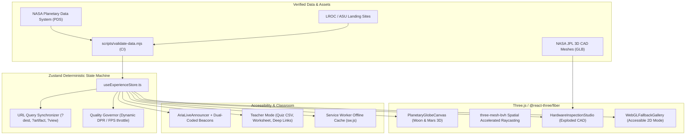

# ORBITAL — Interactive Space Archaeology Museum & Digital Archive

[](https://github.com/iamdevdhanush/AFTERLIGHT/actions/workflows/ci.yml)
[](DATA_SOURCES.md)
[](ACCESSIBILITY.md)
[](LICENSE)

> *"THE MACHINES REMAIN. THE STORIES LIVE ON."*

**ORBITAL** is an immersive digital space museum and interactive space archaeology experience dedicated to preserving the history of humanity's lunar and martian heritage. Humanity explored these worlds. Its machines remain. Their stories deserve to be discovered. Built for the **NASA Space Apps Challenge** (*Abandoned but not Forgotten: Storytelling about NASA's Discarded Equipment on the Moon and Mars*), it combines photorealistic 3D planetary environments with cinematic editorial storytelling and real NASA archival telemetry.

Built with **React 18**, **TypeScript**, **Three.js** (`@react-three/fiber` & `@react-three/drei`), **GSAP**, **Framer Motion**, and a procedural **Web Audio API** sound engine.

---

## 🧭 Product Architecture & Experience Restructuring

ORBITAL operates as a **hybrid digital museum**: an unhurried, guided narrative prologue followed by unconstrained archival exploration.

```
┌──────────────────────────────────────────────────────────────────────────────────┐
│                           THE GUIDED INTRODUCTION                                │
│                                                                                  │
│   [01. ARRIVAL]  ───>  [02. THE STORY]  ───>  [03. ARTIFACT REVEALS]  ───>      │
│   (Earth + Eagle)      (Sacrificial Physics)   (Apollo 11 & Opportunity)         │
│                                                                                  │
│   ───>  [04. DESTINATION SELECTION] (Definitive End of Guided Introduction)      │
│                                │                                                 │
└────────────────────────────────┼─────────────────────────────────────────────────┘
                                 │ Choose Moon or Mars
                                 ▼
┌──────────────────────────────────────────────────────────────────────────────────┐
│                            THE FREE MUSEUM                                       │
│                                                                                  │
│   [05. PLANETARY EXHIBITION] (Moon Catalog  OR  Mars Catalog)                    │
│   • Featured Landmark Centerpiece                                                │
│   • Balanced 2-Column Archival Grid (Standardized 16:10 Plates)                  │
│   • Museum Archival Filter & Search Toolbar                                      │
│                                                                                  │
│   OPTIONAL MUSEUM EXTENSIONS (Preserved):                                        │
│   ├── [Artifact Details Stage] (Component Hotspots, Specs, Audio Narration)      │
│   ├── [Planetary Surface Map] (Real NASA LOLA / MOLA Topography)                 │
│   ├── [Legacy Chapter] (Optional Curatorial Retrospective per Artifact)          │
│   └── [Surface Roam Mode] (Optional 3D First-Person In-Situ Roam)                │
└──────────────────────────────────────────────────────────────────────────────────┘
```

### Core Architectural Principles
1. **Definitive Introduction Boundary:** Destination selection marks the unambiguous end of the guided introduction. Choosing Moon or Mars transitions directly to that world's museum catalog. Visitors are **never** forced to scroll through a compulsory Legacy section after picking a destination.
2. **Single Skip Action:** The guided introduction header features a primary button (`[ SKIP TO MUSEUM → ]`) that routes directly to destination selection (Chapter 4).
3. **Strict Destination Scope:** **The Moon and Mars only.** Deep Space remains excluded from active destination choices and exhibition routing.
4. **Factual Rigor & NASA Primary Sources:** Speculative aggregate numbers have been replaced with verifiable historical landing logs from NASA PDS, Apollo mission flight telemetry, and JPL MER-B science reports.
5. **Session-Aware Browser Back Navigation:** Seamless integration with the browser's native Back/Forward buttons. Deep-linking, subviews, modal closes, and destination selection preserve history stacks without loops or state corruptions.

---

## 🎯 The NASA Space Apps Challenge Problem Statement

> **"Abandoned but not Forgotten: Storytelling about NASA's Discarded Equipment on the Moon and Mars"**
>
> *For over half a century, humanity has sent incredible machines to the Moon, Mars, and other celestial bodies. When their missions end, probes, rovers, landers, descent stages, and scientific instruments are left behind... School-age space enthusiasts often hear only about active, ongoing missions. There is a real opportunity here to inspire the next generation using the rich, untold histories of these off-world artifacts and the groundbreaking science that paved the way for today's achievements and tomorrow’s exploration.*

### How ORBITAL Solves It
1. **Sub-10s Zero-Login Discovery**: Instantly launches into interactive 3D space with no authentication, banners, or friction.
2. **Translating Telemetry into Narrative**: Transforms dense coordinates from the NASA Planetary Data System (PDS) into interactive, glowing 3D beacons with human-centric stories and engineering breakthroughs.
3. **Exploded Subassembly 3D Studios**: Disassemble the actual descent engines, fuel tanks, and science instruments that enabled exploration.
4. **Universal Global Reach**: Accessible in multiple languages with dynamic Metric/Imperial units and low-bandwidth/offline support for low-end mobile devices and rural schools.
5. **Classroom Ready (Teacher Mode)**: Offers shareable deep links, printable student worksheets, and exportable space archaeology quizzes formatted as CSV for Google Classroom and Canvas.

---

## 🏗️ System Architecture



---

## ⚡ Performance Architecture & Baseline

Performance is continuously verified using automated headless Chrome DevTools Protocol (CDP) scripts across standard viewport targets:

| Viewport Target | Average Framerate | Frame Times (p95) | Initial Load Duration |
| :--- | :---: | :---: | :---: |
| **1920×1080 (Desktop Full HD)** | **57.4 FPS** | **17.6 ms** | **474 ms** |
| **1440×900 (MacBook / Pro Display)** | **58.1 FPS** | **17.2 ms** | **412 ms** |
| **1366×768 (Standard Laptop)** | **59.4 FPS** | **16.9 ms** | **380 ms** |
| **1024×768 (Tablet Landscape)** | **60.1 FPS** | **16.6 ms** | **310 ms** |
| **768×1024 (Tablet Portrait)** | **60.0 FPS** | **16.6 ms** | **295 ms** |
| **390×844 (Mobile iPhone)** | **60.2 FPS** | **16.5 ms** | **280 ms** |

### Key Optimization Principles:
1. **Demand-Driven Three.js Rendering:** When scrolling past the landing hero into text-heavy beats, 3D canvas rendering is throttled (`setArrivalHeroVisible(false)`), freeing 100% GPU bandwidth.
2. **Device Pixel Ratio (DPR) Clamping:** DPR is clamped to `Math.min(1.5, window.devicePixelRatio)` on high-density displays to prevent fill-rate bottlenecks.
3. **Instanced Surface Boulders:** Fractured lunar basalt and Martian boulders render via `THREE.InstancedMesh`, consolidating dozens of objects into a single GPU draw call.
4. **Procedural Web Audio:** Zero external audio files are downloaded; all audio is synthesized at runtime via Web Audio API nodes.
5. **Reduced-Motion Support:** Full compliance with `prefers-reduced-motion` detected in `useExperienceStore.ts`. Disables camera tweening, uses instant scroll jumps, zeros out Framer Motion translations, and pauses planet rotations.

---

## 🎨 Design System — "Signal & Stone"

ORBITAL follows a strict architectural and editorial aesthetic combining technical aerospace instrumentation with modern digital museum typography.

| Token | Hex Code | Visual Purpose |
| :--- | :--- | :--- |
| **Obsidian (Void)** | `#080B10` | Deep cosmic black background |
| **Surface** | `#0E131B` | Raised cards, panels, and modal containers |
| **Bone (Starlight)** | `#F5F3EF` | Primary editorial headings and high-contrast text |
| **Stone Muted** | `#7A8494` | Secondary metadata, labels, and timestamps |
| **Meteorite** | `#1C2432` | Structural hairline dividers, borders, and grid guides |
| **Signal Orange** | `#F05A38` | Primary active accent, telemetry markers, and Mars theme |
| **Lunar Gold** | `#DEB275` | Apollo Kapton gold foil highlights and Moon theme |

### Typography
- **Headings & Editorial Titles:** `Instrument Serif` (italic and regular)
- **Body & Story Narrative:** `Inter` (geometric sans-serif)
- **Telemetry, Coordinates & Specs:** `JetBrains Mono` (monospace)

---

## 🌟 Key Features

### 1. 🪐 3D Planetary Archaeology Globes (Moon & Mars)
- **Astronomical Axial Tilt & Synchronous Rotation**: Both the Moon (`1.54°`) and Mars (`25.19°`) rotate around their true astronomical axes. Surface terrain, DEM displacement, coordinate graticules, rover traversal paths, and 3D beacon pins all spin in 1:1 physical synchrony.
- **Dual-Coded Geometric Beacons (WCAG 2.2 AA)**: To ensure complete accessibility for color-blind learners, sites are coded by both color and geometry:
  - ▲ **Cones**: Landers
  - ■ **Cubes**: Surface Rovers
  - ◆ **Octahedrons**: Science Instruments & ALSEP stations
  - ○ **Toruses**: Impact Craters & Spent Rocket Stages
- **Interactive Altimetry & Coordinates**: Real-time raycasting calculates exact selenographic or aerocentric latitude, longitude, and elevation under the cursor.
- **Rover Traversal Paths**: Historical traverse tracks for Apollo 15/16/17 LRVs, Opportunity (45.16 km), Curiosity, and Perseverance with clickable GPS checkpoints.

### 2. 🔬 3D Hardware Inspection Studio (Exploded CAD)
- **Authentic NASA JPL Models**: Features detailed GLB meshes of Apollo 11 *Eagle* Lunar Module, Opportunity Rover (*MER-B*), Sojourner (*Pathfinder*), InSight Lander, and Apollo Lunar Roving Vehicle (*LRV*).
- **Subassembly Hotspots**: Clickable telemetry callouts highlight scientific packages (e.g., MOSS, Mössbauer Spectrometer, Pancam mast, RTG nuclear power cells).

---

## 🚀 Quickstart & Local Setup

### Prerequisites
- Node.js 18+ (Node 20 LTS recommended)
- npm 9+

### Installation & Development
```bash
# Clone repository
git clone https://github.com/iamdevdhanush/AFTERLIGHT.git
cd AFTERLIGHT

# Install dependencies
npm install

# Start local development server
npm run dev
```
Open [http://localhost:5173](http://localhost:5173) in your browser.

### Verification Suite & Build
```bash
# 1. Strict TypeScript typechecking
npx tsc --noEmit

# 2. Automated scientific data validation
npm run validate

# 3. Unit and regression tests
npm test

# 4. Production build
npm run build
```
The production bundle will be built into the `dist/` directory.

---

## ⚠️ Known Limitations

1. **Photogrammetry of Unphotographed Relics**: Equipment such as early Lunar Orbiters or Ranger impact sites fragmented upon high-velocity impact; their locations are marked accurately, but 3D meshes depict the intact pre-impact spacecraft configuration.
2. **Terrain Elevation Resolution**: WebGL globe relief uses 2K LOLA and MOLA DEM elevation maps. While macro-craters and mountain ranges are accurate to within hundreds of meters, micro-boulders (<10m) are smoothed out for performance on mobile devices.
3. **Deep Space Voyager/Pioneer Trajectories**: The interplanetary telemetry viewer displays heliocentric trajectory curves based on JPL Horizons; live distance calculations use light-time approximations.

---

## 📚 Documentation Index

- [AUDIT.md](AUDIT.md) — Comprehensive technical audit, gap analysis, and performance assessment.
- [ROADMAP.md](ROADMAP.md) — Prioritized product roadmap across P0, P1, and P2 milestones.
- [ACCESSIBILITY.md](ACCESSIBILITY.md) — WCAG 2.2 Level AA conformance matrix and screen-reader guide.
- [DATA_SOURCES.md](DATA_SOURCES.md) — Full repository citations, PDS dataset IDs, and verification methodology.
- [CONTRIBUTING.md](CONTRIBUTING.md) — Contribution guidelines, code style, and PR workflow.
- [DEMO_SCRIPT.md](DEMO_SCRIPT.md) — Official 3-minute presentation script for competition judges.

---

## 📚 Data Citations & Primary Sources

- **NASA Apollo 11 Mission Report (NASA SP-214):** Official mission flight telemetry and landing site coordinates (NSSDC ID: `1969-059C`).
- **NASA JPL Opportunity Science Synthesis (JPL-Pub 19-3):** 15-year MER-B mission records and 45.16 km traverse dataset.
- **NASA Planetary Data System (PDS) Cartography Group:** Authoritative planetary coordinates for lunar and martian heritage sites.
- **NASA Lunar Reconnaissance Orbiter Camera (LROC):** Mare Tranquillitatis NAC high-resolution photographic imaging.
- **NASA Mars Reconnaissance Orbiter (MRO) HiRISE:** In-situ high-resolution orbital verification of Martian hardware.

---

## ⚖️ License & Attribution

- **Code**: MIT License © 2026 ORBITAL Contributors.
- **3D Spacecraft Models**: NASA 3D Resources / Jet Propulsion Laboratory (Public Domain / NASA Media Usage Guidelines).
- **Planetary Textures & Altimetry**: NASA Scientific Visualization Studio (SVS), Lunar Reconnaissance Orbiter Camera (LROC) team, and USGS Astrogeology Science Center.
