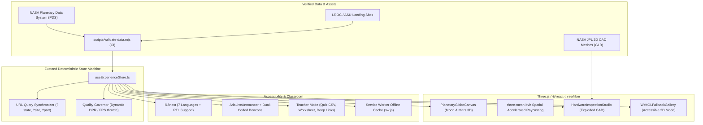

# AFTERLIGHT — Planetary Archaeology & Off-World Heritage Museum

[](https://github.com/shettyadi57/AFTERLIGHT/actions/workflows/ci.yml)
[](DATA_SOURCES.md)
[](ACCESSIBILITY.md)
[-orange)](src/i18n/index.ts)
[](LICENSE)

> *Every machine leaves a story. From the Sea of Tranquillity to Jezero Crater, humanity's robotic pioneers remain standing as silent monuments across the solar system.*

**AFTERLIGHT** is an open-source, museum-grade planetary archaeology platform and interactive educational suite built for the **2026 NASA Space Apps Challenge** (*Abandoned but not Forgotten: Storytelling about NASA's Discarded Equipment on the Moon and Mars*).

Built with React 18, TypeScript, Three.js (`@react-three/fiber` & `@react-three/drei`), `three-mesh-bvh`, GSAP, and Tailwind CSS, AFTERLIGHT pairs real-time 3D orbital globes of the Moon and Mars with authentic NASA JPL CAD models, exploded-view subassembly engineering studios, offline PWA capabilities, and classroom-ready educational tools.

---

## 🎯 The NASA Space Apps Challenge Problem Statement

> **"Abandoned but not Forgotten: Storytelling about NASA's Discarded Equipment on the Moon and Mars"**
>
> *For over half a century, humanity has sent incredible machines to the Moon, Mars, and other celestial bodies. When their missions end, probes, rovers, landers, descent stages, and scientific instruments are left behind... School-age space enthusiasts often hear only about active, ongoing missions. There is a real opportunity here to inspire the next generation using the rich, untold histories of these off-world artifacts and the groundbreaking science that paved the way for today's achievements and tomorrow’s exploration.*
>
> *People looking to learn about past space missions often work through dense technical websites or historical textbooks that lack the spark of imagination and storytelling needed to capture a younger or more casual audience's attention.*

### How AFTERLIGHT Solves It
1. **Sub-10s Zero-Login Discovery**: Instantly launches into interactive 3D space with no authentication, banners, or friction.
2. **Translating Telemetry into Narrative**: Transforms dense coordinates from the NASA Planetary Data System (PDS) into interactive, glowing 3D beacons with human-centric stories and engineering breakthroughs.
3. **Exploded Subassembly 3D Studios**: Students do not just look at 3D hulls—they disassemble the actual descent engines, fuel tanks, and science instruments that enabled exploration.
4. **Universal Global Reach**: Accessible in 7 languages (English, Hindi, Spanish, French, Arabic [RTL], Mandarin, Portuguese) with dynamic Metric/Imperial units and low-bandwidth/offline support for low-end mobile devices and rural schools.
5. **Classroom Ready (Teacher Mode)**: Offers shareable deep links, printable 1-page student worksheets, and exportable 10-question space archaeology quizzes formatted as CSV for Google Classroom and Canvas.

### Typography
- **Headings & Editorial Titles:** `Instrument Serif` (italic and regular)
- **Body & Story Narrative:** `Inter` (geometric sans-serif)
- **Telemetry, Coordinates & Specs:** `JetBrains Mono` (monospace)

## 🏗️ System Architecture



---

## 🌟 Key Features

### 1. 🪐 3D Planetary Archaeology Globes (Moon & Mars)
- **Astronomical Axial Tilt & Synchronous Rotation**: Both the Moon (`1.54°`) and Mars (`25.19°`) rotate around their true astronomical axes. Surface terrain, DEM displacement, coordinate graticules, rover traversal paths, and 3D beacon pins all spin in 1:1 physical synchrony.
- **Dual-Coded Geometric Beacons (WCAG 2.2 AA)**: To ensure complete accessibility for color-blind learners, sites are coded by both color and geometry:
  - ▲ **Cones**: Landers
  - ■ **Cubes**: Surface Rovers
  - ◆ **Octahedrons**: Science Instruments & ALSEP stations
  - ○ **Toruses**: Impact Craters & Spent Rocket Stages
- **Interactive Altimetry & Coordinates**: Real-time raycasting calculates exact selenographic or aerocentric latitude, longitude, and elevation under the cursor.
- **Rover Traversal Paths**: Historical traverse tracks for Apollo 15/16/17 LRVs, Opportunity (45.16 km), Curiosity, and Perseverance with clickable GPS checkpoints.

### 2. 🔬 3D Hardware Inspection Studio (Exploded CAD)
- **Authentic NASA JPL Models**:
  - **Apollo 11 Lunar Module "Eagle" (LM-5)**: 134 mesh nodes including DPS engine bell, hypergolic tanks, landing gear, and EASEP science bay.
  - **Mars 2020 Perseverance Rover**: Mastcam-Z, MMRTG nuclear power unit, titanium chevron wheels, and robotic sample arm.
  - **InSight Mars Lander**: Dual UltraFlex solar arrays, SEIS seismometer dome, and HP³ mole probe.
- **`three-mesh-bvh` Spatial Acceleration**: High-precision mesh-level raycasting for instantaneous subsystem detection without bounding box ambiguity.
- **Exploded View Mechanical Slider**: Smoothly separates subassemblies along their mechanical explosion vectors while 3D numbered hotspot callouts remain pinned to their physical hardware anchors.
- **Scientific Citation Badging**: Every part displays verified launch mass, function, NASA PDS citation link, and an instant "Report Correction" button.

### 3. 🌍 Global Accessibility & Internationalization (i18n)
- **7 Languages Supported**: English (`en`), Hindi (`hi`), Spanish (`es`), French (`fr`), Arabic (`ar` with full RTL layout), Mandarin (`zh`), and Portuguese (`pt`).
- **Unit System Toggle**: Instant toggle between Metric ($km, m, kg$) and Imperial ($mi, ft, lb$).
- **Offline PWA Support**: Pre-cached shell, 3D models, and textures via `public/sw.js` and `manifest.json`.
- **Adaptive Quality Governor**: Real-time frame-rate monitor dynamically throttles pixel ratio, shadow passes, and displacement when frame rate drops below 28 FPS, guaranteeing 30+ FPS on budget mobile devices.
- **Accessible 2D Fallback Gallery**: If WebGL is unavailable or disabled, the application seamlessly presents an archival exhibition with high-resolution photography and complete telemetry dossiers.

### 4. 🍎 Teacher Mode & Classroom Suite
- **Direct Shareable Deep Links**: Point students straight to any landing site or subassembly (`?site=apollo11&part=descent-engine`).
- **One-Click Printable Worksheet**: High-contrast, ink-friendly printable lesson sheet with mission briefs, vocabulary, and guided inquiry questions.
- **10-Question Space Archaeology Quiz**: Exportable directly as a `.csv` file formatted for Google Classroom, Canvas, Blackboard, or Excel.
- **Embeddable Museum Widget**: Includes an iframe snippet generator for school science portals and museum kiosks.

---

## 📊 Scientific Data Integrity & Verification

All coordinates and specifications in AFTERLIGHT are validated against primary NASA and USGS repositories. We enforce an automated validation script in our CI pipeline:

```bash
npm run validate
```

- **Checks Executed**: 281 automated rules across all landing sites, coordinates, and CAD manifests.
- **Coordinate Validation**: Ensures all selenographic and aerocentric coordinates stay strictly within valid mathematical boundaries ($[-90^\circ, +90^\circ]$ lat, $[-180^\circ, +180^\circ]$ or $[0^\circ, 360^\circ]$ lon).
- **Zero Fabrication**: Every claim has an associated URL from `nasa.gov`, `usgs.gov`, or `lroc.sese.asu.edu`.

For full dataset IDs and geodetic frames, see [DATA_SOURCES.md](DATA_SOURCES.md).

---

## ⌨️ Controls & Navigation

| Context | Action | Controls |
| :--- | :--- | :--- |
| **Orbital Globe** | Rotate Globe | Left-click + drag / Arrow keys |
| | Zoom In / Out | Scroll wheel / `+` and `-` keys |
| | Inspect Site | Click beacon pin or press `Enter` |
| | Toggle Spin | Click `ORBIT SPIN` or press `Space` |
| | Switch Celestial Body | Click `MOON` or `MARS` |
| **Hardware Studio** | Pick Subassembly | Click directly on geometry or hotspot |
| | Disassemble CAD | Drag `EXPLODE` slider |
| | Cycle Subsystems | `←` Left / `→` Right arrow keys |
| | Close / Return | Press `Escape` |

---

## 🚀 Quickstart & Local Setup

### Prerequisites
- Node.js 18+ (Node 20 LTS recommended)
- npm 9+

### Installation
```bash
# Clone repository
git clone https://github.com/shettyadi57/AFTERLIGHT.git
cd AFTERLIGHT

# Install dependencies
npm install

# Start local development server
npm run dev
```
Open [http://localhost:5173](http://localhost:5173) in your browser.

### Verification Suite
```bash
# 1. Strict TypeScript typechecking
npx tsc --noEmit

# 2. Automated scientific data validation
npm run validate

# 3. Unit and regression tests
npm test

# 4. Production build
npm run build
```
The production bundle will be built into the `dist/` directory.

### Running Audits and Benchmark Scripts
- **Inspect 3D GLB Meshes:**
  ```bash
  node scripts/audit-glb-meshes.mjs
  ```
- **Run Headless Browser Performance Benchmark (CDP):**
  ```bash
  node scratch/benchmark_performance.cjs
  ```

---

## ⚠️ Known Limitations

1. **Photogrammetry of Unphotographed Relics**: Equipment such as early Lunar Orbiters or Ranger impact sites fragmented upon high-velocity impact; their locations are marked accurately, but 3D meshes depict the intact pre-impact spacecraft configuration.
2. **Terrain Elevation Resolution**: WebGL globe relief uses 2K LOLA and MOLA DEM elevation maps. While macro-craters and mountain ranges are accurate to within hundreds of meters, micro-boulders (<10m) are smoothed out for performance on mobile devices.
3. **Deep Space Voyager/Pioneer Trajectories**: The interplanetary telemetry viewer displays heliocentric trajectory curves based on JPL Horizons; live distance calculations use light-time approximations.

---

## 📚 Documentation Index

- [AUDIT.md](AUDIT.md) — Comprehensive technical audit, gap analysis, and performance assessment.
- [ROADMAP.md](ROADMAP.md) — Prioritized product roadmap across P0, P1, and P2 milestones.
- [ACCESSIBILITY.md](ACCESSIBILITY.md) — WCAG 2.2 Level AA conformance matrix and screen-reader guide.
- [DATA_SOURCES.md](DATA_SOURCES.md) — Full repository citations, PDS dataset IDs, and verification methodology.
- [CONTRIBUTING.md](CONTRIBUTING.md) — Contribution guidelines, code style, and PR workflow.
- [DEMO_SCRIPT.md](DEMO_SCRIPT.md) — Official 3-minute presentation script for competition judges.

---

## ⚖️ License & Attribution

- **Code**: MIT License © 2026 AFTERLIGHT Contributors.
- **3D Spacecraft Models**: NASA 3D Resources / Jet Propulsion Laboratory (Public Domain / NASA Media Usage Guidelines).
- **Planetary Textures & Altimetry**: NASA Scientific Visualization Studio (SVS), Lunar Reconnaissance Orbiter Camera (LROC) team, and USGS Astrogeology Science Center.
